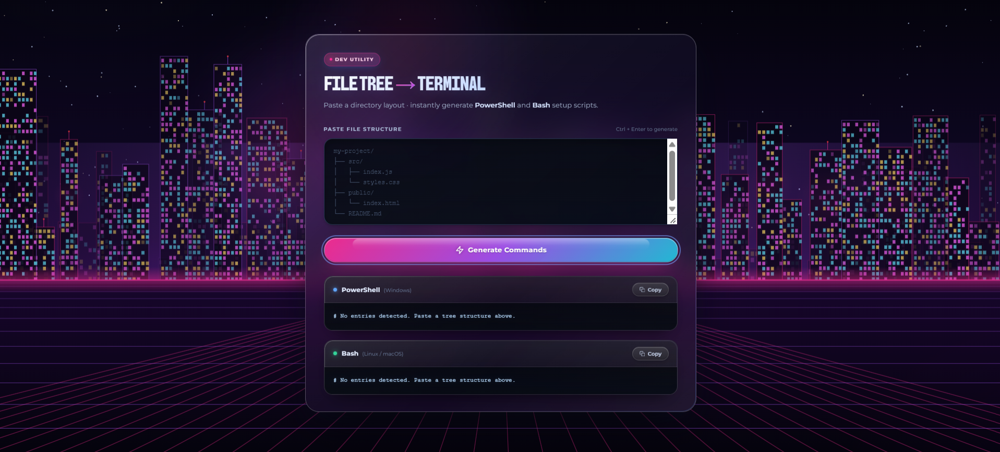

# 📁 File Tree → Terminal Command Generator

> **Paste a directory tree. Get PowerShell and Bash setup scripts. Instantly.**

A modern developer utility that parses pasted file/folder structures and generates ready-to-run terminal commands to recreate that exact structure — no more `mkdir -p a/b/c && touch a/b/c/d.js` tedium.


---

## ✨ Overview

**File Tree → Terminal Command Generator** is a single-page, zero-dependency web tool for developers who scaffold projects frequently. Paste any ASCII tree (the kind you copy from `tree` output, GitHub, or a README) and instantly get:

- 🪟 **PowerShell** script for Windows
- 🐧 **Bash** script for Linux, macOS, and Git Bash

Both scripts are idempotent — safe to run multiple times. It won't overwrite existing files, and it preserves nested folder hierarchy automatically.

Built with a **liquid glass UI** over a **cyberpunk neon skyline** background, with floating gold orbs, particle repulsion, and spring-eased micro-interactions. Designed to feel as good as it works.

---
## Image

## 🚀 Features

### Core
- 🧠 **Smart tree parser** — understands `│`, `├──`, `└──`, indentation, trailing slashes, and file extensions
- 🪟 **PowerShell output** — `New-Item -ItemType Directory/File -Force` with `Test-Path` guards
- 🐧 **Bash output** — `mkdir -p` and `touch` with safe chunking for large trees
- 📋 **One-click copy** — copies either script to clipboard with visual confirmation
- ⌨️ **`Ctrl / Cmd + Enter`** — regenerate without touching the mouse
- 🔁 **Live demo prefill** — loads with a sample tree so you can try it immediately

### Design
- 💎 **Liquid glass panels** — layered gradients, `backdrop-filter` blur + saturation, 1px chromatic border rings
- 🌆 **Cyberpunk background** — animated neon skyline, perspective grid, twinkling stars, pink horizon bloom
- ✨ **Golden floating orbs** — bright drifting gold particles with 4-point sparkle
- 🖱️ **Cursor-reactive** — soft nebula follows the pointer; particles repel on hover and burst on click
- 🎯 **Spring-eased interactions** — buttons, cards, and copy actions with natural-feeling motion
- 📱 **Fully responsive** — mobile-optimized with reduced particle counts, disabled heavy blur, and touch-friendly tap targets
- ♿ **Accessibility aware** — respects `prefers-reduced-motion`, keyboard focus rings, and ARIA labels

---

## 🖼️ Screenshots

> _Add screenshots to `/screenshots/` and reference them here._

| Desktop | Mobile |
|---------|--------|
| `` | `` |

---

## 🧩 How It Works

1. **Paste** a tree into the textarea (e.g. output from `tree`, or a README layout).
2. **Click** *Generate Commands* (or press `Ctrl/Cmd + Enter`).
3. **Copy** the PowerShell or Bash script using the copy buttons.
4. **Run** the script from your target parent folder.

### Example input

```
my-portfolio/
├── index.html
├── css/
│   ├── style.css
│   └── animations.css
├── js/
│   └── app.js
├── assets/
│   ├── images/
│   │   └── profile.jpg
│   └── favicon.ico
└── README.md
```

### Generated PowerShell

```powershell
$dirs = @(
    "my-portfolio",
    "my-portfolio\css",
    "my-portfolio\js",
    "my-portfolio\assets",
    "my-portfolio\assets\images"
)
foreach ($d in $dirs) {
    if (-not (Test-Path -LiteralPath $d)) { New-Item -ItemType Directory -Force -Path $d | Out-Null }
}

$files = @(
    "my-portfolio\index.html",
    "my-portfolio\css\style.css",
    "my-portfolio\css\animations.css",
    "my-portfolio\js\app.js",
    "my-portfolio\assets\images\profile.jpg",
    "my-portfolio\assets\favicon.ico",
    "my-portfolio\README.md"
)
foreach ($f in $files) {
    if (-not (Test-Path -LiteralPath $f)) { New-Item -ItemType File -Force -Path $f | Out-Null }
}
```

### Generated Bash

```bash
#!/usr/bin/env bash
set -e

mkdir -p "my-portfolio" \
         "my-portfolio/css" \
         "my-portfolio/js" \
         "my-portfolio/assets" \
         "my-portfolio/assets/images"

touch "my-portfolio/index.html" \
      "my-portfolio/css/style.css" \
      "my-portfolio/css/animations.css" \
      "my-portfolio/js/app.js" \
      "my-portfolio/assets/images/profile.jpg" \
      "my-portfolio/assets/favicon.ico" \
      "my-portfolio/README.md"
```

---

## 🗂️ Project Structure

```
file-tree-generator/
├── index.html            # Markup — semantic, accessible, single page
├── style.css             # Liquid glass UI + cyberpunk overrides
├── script.js             # Tree parser, script generators, copy logic
├── cyberpunk-bg.js       # Canvas neon skyline + perspective grid + stars
└── README.md
```

Each file has a single responsibility. No frameworks, no bundler, no `node_modules` — just open `index.html` in a browser.

---

## 🛠️ Tech Stack

| Layer | Choice | Why |
|---|---|---|
| Markup | HTML5 | Semantic, zero framework overhead |
| Styling | Vanilla CSS | Full control over the glass + neon aesthetic |
| Logic | Vanilla ES2020+ | No dependencies, tiny footprint |
| Background | Canvas 2D API | Smooth 60fps neon skyline at any DPR |
| Fonts | Montserrat + BBH Bogle | Clean UI text + striking display face |
| Icons | Inline SVG | Crisp at any size, no icon font |

**No build step. No dependencies. No tracking. Just files.**

---

## 📦 Getting Started

### Run locally

```bash
git clone https://github.com/your-username/file-tree-generator.git
cd file-tree-generator
```

Then simply open `index.html` in your browser. For clipboard API support, serve over `http(s)`:

```bash
# With Python
python3 -m http.server 8080

# With Node
npx serve .

# With PHP
php -S localhost:8080
```

Visit **http://localhost:8080**.

### Deploy

Drop the four files onto any static host:

- **GitHub Pages** — push to `gh-pages` or enable Pages on `main`
- **Netlify** — drag-and-drop the folder, or connect the repo
- **Vercel** — import the repo, no config needed
- **Cloudflare Pages** — same, zero config

No environment variables, no server, no build step.

---

## 🎨 Customization

### Recoloring the theme

All colors are CSS custom properties at the top of `style.css`:

```css
:root {
  --accent: #3b82f6;      /* primary blue */
  --accent-2: #8b5cf6;    /* violet */
  --accent-3: #06b6d4;    /* cyan */
  --glass-tint: rgba(255, 255, 255, 0.055);
  --glass-border: rgba(255, 255, 255, 0.14);
}
```

### Tuning the neon skyline

Knobs live at the top of `cyberpunk-bg.js`:

```javascript
const config = {
  skyColor: "#0a0410",
  neonPink: "#ff2d95",
  neonPurple: "#a855f7",
  neonCyan: "#22d3ee",
  speed: 1.4,              // grid scroll speed
  buildingDensity: 0.075,  // buildings per 100px
  farBuildingAlpha: 0.35,  // distant buildings dimmer
  nearBuildingAlpha: 0.85,
};
```

### Tuning the gold particles

If you ever re-enable the particle system (`particles.js`):

```javascript
const GOLD_CHANCE = 0.38;        // ratio of gold vs blue particles
const GOLD_ORB_MIN = 8;          // min floating gold orbs
const GOLD_ORB_MAX = 18;         // max floating gold orbs
```

### Swapping fonts

Replace the Google Fonts `<link>` in `index.html` and update:

```css
--font-body: "Your Sans", system-ui, sans-serif;
--font-display: "Your Display", "Your Sans", sans-serif;
```

---

## 🧪 Browser Support

| Browser | Status |
|---|---|
| Chrome / Edge 90+ | ✅ Full support |
| Firefox 88+ | ✅ Full support |
| Safari 15+ | ✅ Full support (with `-webkit-` fallbacks) |
| Mobile Safari 15+ | ✅ Optimized |
| Mobile Chrome 90+ | ✅ Optimized |

Graceful degradation:
- No `backdrop-filter`? Solid fallback tint.
- `prefers-reduced-motion`? Animations disabled, background static.
- No clipboard API? Falls back to `execCommand('copy')`.
- No JS? Static markup shows the placeholder text.

---

## ⌨️ Keyboard Shortcuts

| Shortcut | Action |
|---|---|
| `Ctrl / Cmd + Enter` | Generate commands |
| `Tab` | Navigate between input and buttons |
| `Enter` on focused copy button | Copy script |

---

## 🤝 Contributing

Contributions are welcome. To keep the codebase clean:

1. **Fork** the repo and create a branch: `git checkout -b feat/your-feature`
2. **Keep it vanilla** — no frameworks, no bundlers, no new deps
3. **Match the style** — 2-space indent, functional-first, small files
4. **Test across browsers** — check Chrome, Firefox, and Safari
5. **Update the README** if you add a feature or change behavior
6. **Open a PR** with a clear description and screenshots for UI changes

### Reporting bugs

Open an issue with:
- **Steps to reproduce**
- **Expected vs actual behavior**
- **Browser + OS**
- **The exact tree you pasted** (sanitize anything sensitive)

---

## 🗺️ Roadmap

- [ ] Zsh / Fish script output
- [ ] Windows `cmd.exe` output
- [ ] Drag-and-drop `.txt` / `.tree` file input
- [ ] Save / load trees via `localStorage`
- [ ] Export scripts as downloadable `.ps1` / `.sh` files
- [ ] Optional file template prefill (e.g. `index.html` with boilerplate)
- [ ] Theme switcher (blue · gold · cyberpunk · light)

---

## 📄 License

MIT © 2025 — free to use, modify, and distribute. See [LICENSE](LICENSE).

---

## 🙏 Credits

- **Fonts** — [Montserrat](https://fonts.google.com/specimen/Montserrat) and [BBH Bogle](https://fonts.google.com/specimen/BBH+Bogle) via Google Fonts
- **Neon skyline inspiration** — the classic synthwave/grid aesthetic, adapted for the browser canvas
- **Glassmorphism techniques** — the `mask-composite: exclude` border trick, widely documented in the CSS community

---

## ⭐ Support

If this tool saved you five minutes of `mkdir`-ing, consider starring the repo — it helps more developers find it.

**[⬆ Back to top](#-file-tree--terminal-command-generator)**
